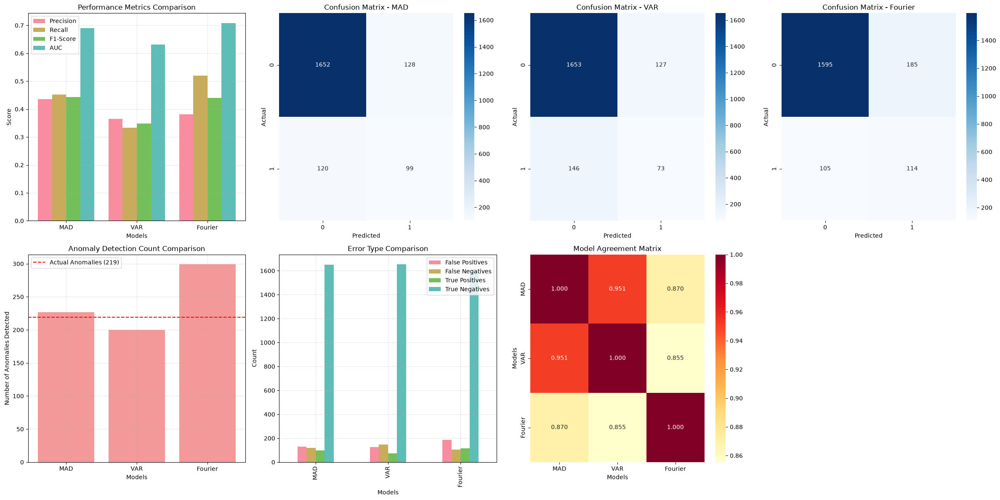

# ECG Time-Series Anomaly Detection (ECG5000)

Three **unsupervised** anomaly detectors for heartbeat recordings, compared on the same data:
a statistical rule (median absolute deviation), a vector autoregression (VAR) reconstruction model,
and Fourier spectral features. Labels are never used for training, only to evaluate and to analyse
the errors afterwards.

## Results

All three models scored on the same 1,999 recordings (219 anomalies):

| Model | Precision | Recall | F1 | AUC* | TP | FP | FN |
|---|---|---|---|---|---|---|---|
| **Median Absolute Deviation (rule)** | **0.44** | 0.45 | **0.44** | 0.69 | 99 | 128 | 120 |
| VAR reconstruction error | 0.37 | 0.33 | 0.35 | 0.63 | 73 | 127 | 146 |
| Fourier spectral features | 0.38 | **0.52** | 0.44 | **0.71** | 114 | 185 | 105 |

\*AUC is computed from the binary predictions, so it equals balanced accuracy, not a ranking AUC.

**What this shows**

- The simple statistical rule matches the best model on F1. Fourier features catch the most
  anomalies (recall 0.52) at the cost of more false alarms.
- The detectors agree on 86 to 95% of recordings, so an ensemble would mostly add value on the
  disagreements.
- With an 11% anomaly rate and no labels in training, around half of the anomalies are still
  missed by every model. For a medical use case the threshold would have to move towards recall.



## Data

- [ECG5000](https://www.timeseriesclassification.com/description.php?Dataset=ECG5000):
  heartbeat recordings, 140 time steps each
- A subset of **2,000 recordings** (`data/ECG5000_balanced.csv`): 1,780 normal (class 1) and
  220 anomalous (classes 2 to 5), an 11% anomaly rate
- Binary target for evaluation: 0 = normal, 1 = anomaly

## Methods

1. **Median Absolute Deviation (rule-based)**: a modified z-score (median and MAD, threshold 3.5)
   per time step; a recording is flagged when more than 10% of its time steps are outliers.
   Fast and interpretable.
2. **Vector autoregression (VAR)**: every 10th time step (14 features) is standardised and
   differenced, a VAR model is fitted on the first 80% of recordings, and the one-step forecast
   error is used as the anomaly score (top 10% flagged). Note: VAR treats consecutive recordings
   as a sequence, which is a weak assumption for independent heartbeats and explains why it is
   the weakest of the three.
3. **Fourier transform**: 9 spectral features per recording (total and mean power, spectral
   entropy, mean frequency, spectral centroid and similar), standardised; the Mahalanobis distance
   from the mean is the anomaly score and the top 15% are flagged.

Each notebook includes an error analysis of false positives and false negatives.

## Notebooks

```
notebooks/
├── 1_EDA.ipynb                 # exploratory analysis of the 2,000 recordings
├── 2_RuleBased_Model.ipynb     # median absolute deviation
├── 3_ML_Model1.ipynb           # VAR reconstruction error
├── 4_ML_Model2.ipynb           # Fourier spectral features
└── 5_Model_Comparison.ipynb    # side-by-side metrics, confusion matrices, agreement
```

Run them in order; notebooks 2 to 4 save their predictions to `results/`, which notebook 5 loads.

```bash
pip install -r requirements.txt
jupyter notebook
```

## Changelog

- **Nov 2026**: fixed an alignment bug in the comparison notebook. The VAR model works on
  differenced data, so its predictions start at recording 1; the comparison was matching them to
  recording 0, which made VAR look random (F1 0.10). Aligned correctly, VAR scores F1 0.35, the
  same as in its own notebook. Also corrected "mean" to "median" absolute deviation.

## Limitations

- One dataset subset and one random split; no cross-validation.
- Thresholds are set by percentile, not tuned for a clinical recall target.
- AUC is computed from hard predictions; a score-based ROC curve would be more informative.
